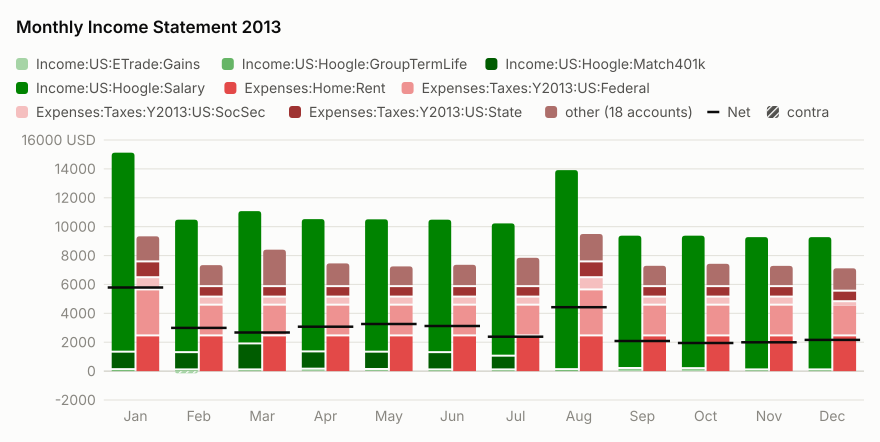
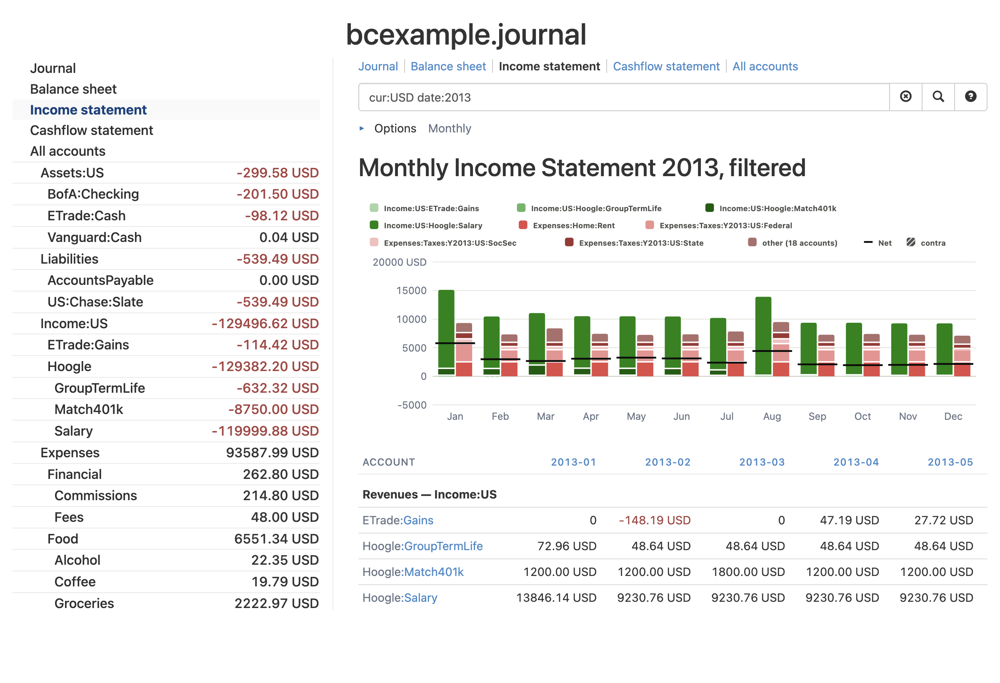

# Charts and Graphs

Tips and techniques for producing charts from hledger data.

## Built-in charts

(Not yet released, you'll need to [build main](install.md#build-from-source) to try it.)
hledger main can show many reports as a chart.
Add `--chart` to a `balance`, `balancesheet`, `balancesheetequity`, `cashflow`, `incomestatement`, `register` or `aregister` report;
the `activity` command always shows one.
A suitable kind of chart is chosen for the report: eg stacked bars per period for balance changes,
lines for balances over time, or a bar per account for a single period.

In the terminal, the chart is drawn with text characters:

```cli
$ hledger -f examples/sample.journal bal -Q expenses income --chart -w 50
Balance changes in 2008:

█ expenses:food  ▓ expenses:supplies
▒ income:gifts  ░ income:salary

2008Q1  $-1  ░░░░░░░░░░░░│
2008Q2   $1  ▒▒▒▒▒▒▒▒▒▒▒▒│████████████▓▓▓▓▓▓▓▓▓▓▓▓
2008Q3    0              │
2008Q4    0              │
```

With SVG output (eg `-o chart.svg`) it is a graphical chart; with HTML output, the report's table is shown below it;
and with CSV, TSV or JSON output you get the chart's data.
To see a graphical chart quickly, in your web browser, add `--view`:

```cli
$ hledger -f examples/bcexample.journal is -M -p 2013 cur:USD --chart --view
```



And to collect several reports and charts into one page, use the `run` command with `--view`, eg
`hledger run --view -- bs -M --chart -- is -M --chart`.

For more, see [Charts](https://hledger.org/dev/hledger.html#charts) in the (dev) manual.

## Charting tools built for hledger

Simplest first:

### hledger-web

hledger-web has a simple balance over time chart, in the register view. ([demo](https://demo.hledger.org/register?q=inacct:Assets:US:ETrade))
```
hledger web
```


### hledger-bar

[hledger-bar](scripts.md#hledger-bar) (2023)
is a bash script for making quick bar charts in the terminal.
It's useful with hledger 1.x, or hledger 2.x previews up to 1.99.5.

```
$ hledger bar -v 1 -f $TIMELOG biz
2023-01	        15 +++++++++++++++
2023-02	        10 ++++++++++
2023-03	        20 ++++++++++++++++++++
2023-04	        12 ++++++++++++
```

### hledger-plot

[hledger-plot](https://pypi.org/project/hledger-utils) (2023)
is a powerful chart-making addon you can install in PATH.


### hledger-lit

[hledger-lit](https://github.com/adept/hledger-lit) (2025)
is a nice web UI that makes several kinds of chart.

### hledger-sankeymatic

At <https://sankeymatic.com> you can make flow diagrams in your browser,
from data records like `Source [Amount] Target`. 

Here's a rough script that exports the outflows from several asset accounts:

```cli
LEDGER_FILE=examples/sample.journal
for f in checking saving cash; do 
  hledger areg $f -O tsv | tail +2 | sed -e "s/^/$f\t/"
done | cut -f1,6,7 | gsed -E -e 's/\$//' -e 's/([^\t]*)\t([^\t]*)\t([^\t]*)/\1 [\3] \2/' | grep '\[-' | gsed 's/\[-/[/'
```

[hledger-sankeymatic](https://github.com/victormihalache/hledger-sankeymatic) is a better script to help you export hledger data to SankeyMATIC.

### hledger-sankey

- <https://github.com/adept/hledger-sankey> is a python script using pandas and plotly to plot three sankey graphs of hledger data
- <https://github.com/JustSaX/hledger-sankey> is hledger-sankey made interactive with Streamlit


### hledger-sankey-visualization

<https://github.com/AlessandroW/hledger-sankey-visualization> is a javascript that reads hledger's JSON output, and uses amCharts.


### hledger-vega

[hledger-vega](https://github.com/xitian9/hledger-vega) (2022) is a set of scripts for producing custom charts
from your hledger reports, using the powerful [vega-lite](https://vega.github.io/vega-lite/).
<!-- <https://nest.pijul.com/hledgerorg/hledger-vega> is another variant -->


### r-ledger

[r-ledger](https://github.com/trevorld/r-ledger) is an R package for making reports and charts from hledger, Ledger or Beancount.


### Grafana export script

[Visualise your finances with hledger, InfluxDB, and Grafana](https://memo.barrucadu.co.uk/hledger-influxdb-grafana.html) (2017)


### docker-finance metadata visualising

docker-finance, a hledger-based system, can [visualise large quantities of metadata](https://gitea.com/EvergreenCrypto/docker-finance#meta-w-root-c-analysis)
using [ROOT](https://root.cern).


## Other charting tools

## Fava

You can export to Beancount format and then use [Fava](https://fava.pythonanywhere.com), a web UI with many charts.
See [Beancount output](https://hledger.org/hledger.html#beancount-output)
or (improved) [Beancount output in 2.x](https://hledger.org/dev/hledger.html#beancount-output).

### Ledger chart tools

Tools built for Ledger can sometimes be adapted to work with hledger also; or, hledger data can be exported to Ledger-readable files. Eg:

- [Report Scripts for Ledger CLI with Gnuplot](https://www.sundialdreams.com/report-scripts-for-ledger-cli-with-gnuplot/) (2016)
- [ledger-plots](https://github.com/esovetkin/ledger-plots) (2018), an R package that makes PDF charts from Ledger

## Spreadsheets

The most general, lowest-common-denominator way is to produce [CSV output](hledger.md#output-format) from a report,
then drag the CSV file into a spreadsheet and use its charting tools.
The `balance` command with --layout=bare and -N/--no-total is most often used. Eg:
```
hledger bal --layout bare -N expenses -o expenses.csv
```

### ploterific

Here's another small example of plotting CSV data.
[ploterific](https://github.com/GregorySchwartz/ploterific) (`stack install hvega-theme ploterific`) produces simple charts,
in a HTML file that uses the [Vega-Lite](https://vega.github.io/vega-lite/) javascript library.
Charts can also be saved as SVG or PNG.

```
hledger -f examples/bcexample.journal bal -O csv -N expenses -3 cur:USD \
    | sed 's/ USD//' \
    | ploterific -m Bar -f account:N -f balance:Q -c account -o a.html \
    && open a.html
```


Let's break down that command line:

- `-f examples/bcexample.journal` - use this example file in the hledger repo. Omit this to use your default journal.
- `bal` - run a [balance report](hledger.md#balance)
- `-O csv` - show it as [CSV](hledger.md#output-format) on stdout
- `-N` - disable the final Total row
- `expenses` - [limit](hledger.md#queries) to accounts whose name contains `expenses`
- `-3` - summarise accounts to [depth](hledger.md#depth) 3 and above
- `cur:USD` - limit to balances in `USD` currency. If you use the `$` symbol, it would be `cur:\\$`.
- `sed 's/ USD//g'` - process the output with [sed](https://www.gnu.org/software/sed/), stripping the ` USD` symbols to leave bare numbers for ploterific. With `$` it would be `sed 's/\$//g'`.
- `-m Bar` - use `Bar` as the Vega-Lite [mark type](https://hackage.haskell.org/package/hvega-0.11.0.1/docs/Graphics-Vega-VegaLite.html#t:Mark)
- `-f account:N` - use the `account` column as the first feature (X axis), treating values as names
- `-f balance:Q` - use the `balance` column as a second feature (Y axis), treating values as quantities
- `-c account` - use `account` values to select colours
- `-o a.html` - save into a temporary HTML file
- `&& open a.html` - and view it in your web browser, on Mac; on other systems it might be `xdg-open` or `start`
