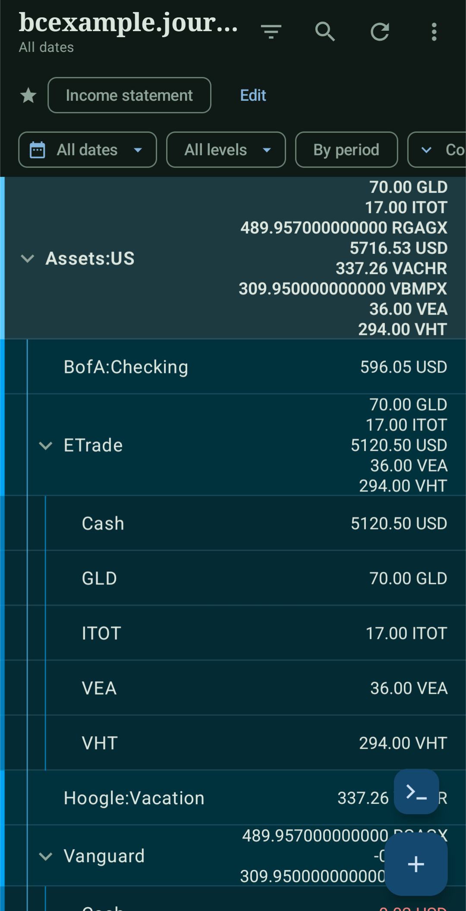
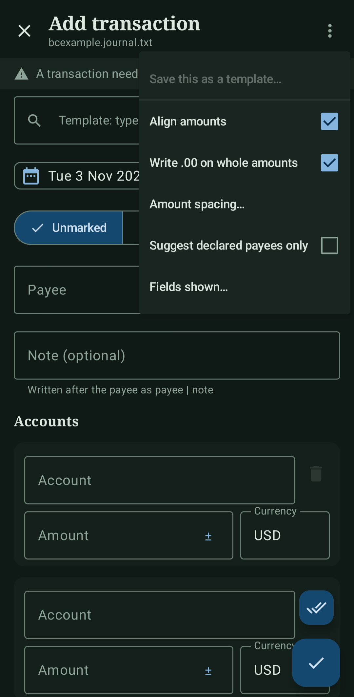
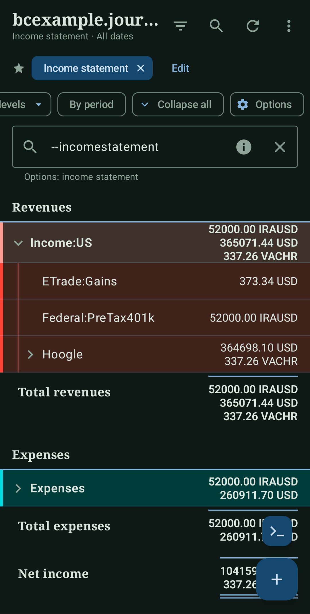
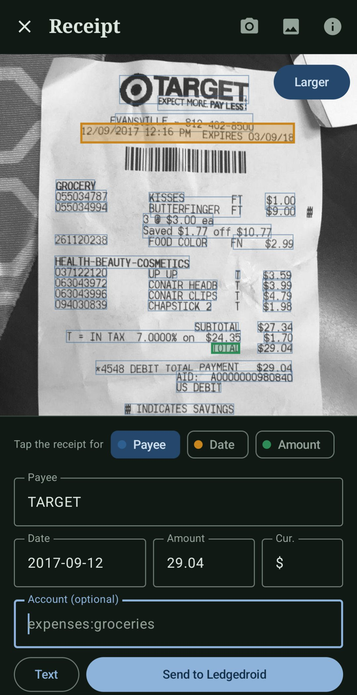

# Mobile apps

Entering expenses on the spot using a mobile device can be convenient. 
One of the challenges is finding apps that focus on making this efficient. 

<https://plaintextaccounting.org/#ui-mobile> is the up to date list of PTA-specific mobile apps.
Most of these are focussed on data entry, then export to a computer for reporting.

## hledger-compatible apps

### Ledgedroid & Receiptdroid (Android, 2026-)

<https://github.com/hnvy/ledgedroid> A full-featured hledger-like app with data entry & reports.

There's also an add-on app for scanning receipts: <https://github.com/hnvy/receiptdroid>

### NanoLedger (Android, 2023-)

<https://github.com/chvp/NanoLedger>\
<https://f-droid.org/packages/be.chvp.nanoledger>

Exports a h/ledger journal.

### Cashier, Cashier II (progressive web apps, 2022-2024)

Cashier:\
<https://github.com/alensiljak/cashier>\
[demo](https://cashier.alensiljak.eu.org)

Cashier II:\
<https://github.com/alensiljak/cashier-blazor>\
[demo](https://cashier-ii.alensiljak.eu.org)

These can be used on a computer or a phone, including offline. 
They can optionally import data from h/ledger using a [server](https://github.com/alensiljak/cashier-server-rust).
They export a new h/ledger journal.
They also provide some reports.

### MoLe (Android, 2018-2024)

<https://mole.ktnx.net>\
<https://git.ktnx.net/?p=mobile-ledger.git>

Connects to a hledger-web server, which you must have running somewhere your phone can connect to (eg a VPS or a VPN).
Ie it can potentially add transactions directly into your main accounting system, without needing an export/import step.

### Cone (Android, 2019-2021)

<https://github.com/bradyt/cone>\
<https://f-droid.org/packages/info.tangential.cone>\
[blog](https://www.chvp.be/blog/nanoledger)

Exports a h/ledger journal.
According to NanoLedger's blog post, it had some bugs when the journal file is synced with Nextcloud, and lags if the file is pretty big.
There was a [report](https://www.reddit.com/r/plaintextaccounting/comments/17sielr/nanoledger_android_app_for_data_entry_with) of data corruption.

Cone vs NanoLedger:

|                          | Cone                                                                           | NanoLedger                                                                           |
| ------------------------ | ------------------------------------------------------------------------------ | ------------------------------------------------------------------------------------ |
| Journal view screen      | Transactions can be sorted by new to old or reversed, and elements are colored | Transactions can only be sorted by new to old, and elements aren't colored           |
| Transaction entry screen | The description field is free form                                           | The description field is split into status field, payee field and note field         |
| Modify old transaction   | No                                                                             | Yes. You can edit or delete old transaction, or use it as the template for a new one |

## Apps with CSV export

Many other apps can export CSV, which hledger can read.

The usual workflow is that every so often you manually initiate a CSV export from the app.
Often the app starts up a temporary HTTP server, and you can fetch the data to your computer with curl.
Then you can use hledger's usual CSV-reading or importing features.

### GnuCash (Android)

<https://github.com/codinguser/gnucash-android>\
[google play](https://play.google.com/store/apps/details?id=org.gnucash.android)

Mobile UI for the mature GnuCash accounting software.

### XpenseTracker, BizXpenseTracker (IOS)

<http://www.silverwaresoftware.com/XpenseTracker.html>

Comprehensive and serviceable money & time tracking apps.

[CSV rules](https://github.com/hledgerorg/hledger/blob/main/examples/csv/xpensetracker.csv.rules)\
[Makefile](https://gist.github.com/simonmichael/06eed26bcc85c76d1604373418bc6c58)

### Eternity (IOS)

<http://www.komorian.com/eternity.html>

An excellent time tracking app.

[CSV rules](https://github.com/hledgerorg/hledger/blob/main/examples/csv/eternity.csv.rules)

## Apps with other ways to export

### Money Manager Ex (Android)

<http://android.moneymanagerex.org>,
<https://github.com/moneymanagerex/android-money-manager-ex>\
Android port of the [Money Manager Ex](https://www.moneymanagerex.org) cross platform finance application.
The [MoneyManagerExLib](https://gitlab.com/alensiljak/moneymanagerexlib) python library can be used to convert its db to *ledger format.

### MyExpenses (Android)

<http://www.myexpenses.mobi>,
<https://github.com/mtotschnig/MyExpenses>

Personal finance manager for Android.

Export to *ledger format: <https://github.com/ony/ledger-myexpenses> (2017)

Sync to/from Ledger: <https://gitlab.com/IanTwenty/ledgermyexpenses> (2023)
